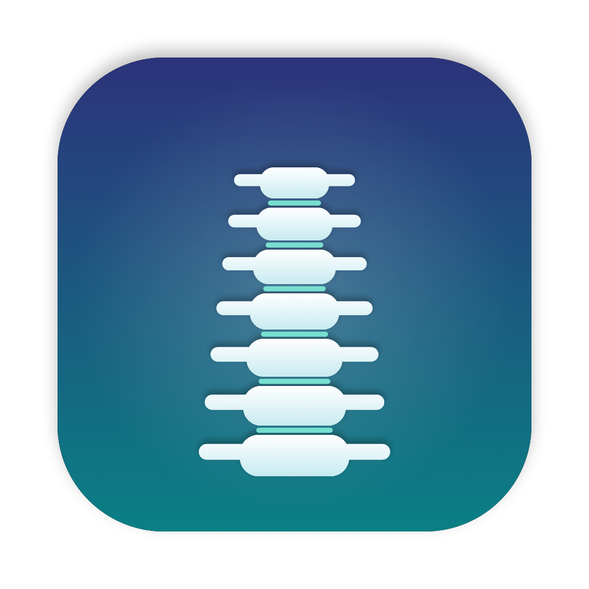

# Rectus

A tiny macOS menu bar app that reminds you to sit up straight.

Start reminders from the menu bar; while they're on, a small box appears at the top of
your screen at the interval you chose ("Sit up straight — shoulders back, chest open"),
with an optional soft sound. Sit up, then click **I'm upright**: that one deliberate click
is the point. A reminder you have to answer is harder to ignore than one that just
passes by.

*Rectus* is Latin for "upright, straight". It's also the name of the *rectus abdominis*,
one of the muscles that holds your posture.

## Features

- Lives in the menu bar: the standing figure is faded while reminders are off, solid while they're on
- Duration: 1, 2 or 3 hours, or until stopped
- Interval: every 15, 20, 30 or 45 min, or **varied** (random, 15–30 min)
- Reminder: a box at the top center of the screen for 8 seconds with an **I'm upright** button, plus an optional sound
- Daily tally in the menu: "Today: 5 of 7 confirmed"
- Sleep-aware: when the Mac goes to sleep the reminders stop; while the display is off
  or locked, reminders are skipped silently. Reading or watching a video without touching
  the keyboard doesn't count as away
- The box never steals focus, so your typing doesn't jump into it
- Remembers your last settings; no Dock icon

## Why these intervals?

There's no proven "right" interval. A [Cochrane review](https://www.cochrane.org/evidence/CD012886_work-break-schedules-preventing-musculoskeletal-symptoms-and-disorders-healthy-workers)
found no clear difference between break schedules (low-quality evidence). The practical
anchor is Cornell's [20-8-2 guideline](https://ergo.human.cornell.edu/CUESitStandPrograms.html),
which suggests changing posture roughly every 20–30 minutes, so the default is 20 min.
Intervals shorter than 15 min were dropped: reminders that come too often get tuned out.
Varied mode exists for the same reason: an unpredictable reminder is harder to ignore than
one that comes like clockwork.

## Install

Requires macOS 14+ and Swift 6 (Xcode, or just the Command Line Tools: `xcode-select --install`).

```bash
git clone https://github.com/Efekan18/Rectus.git
cd Rectus
./build.sh --install
```

The app is installed as `~/Applications/Rectus.app` and launched.
To start it at login: System Settings → General → Login Items → add Rectus.

During development you can run it directly with `swift run`; the debug build also offers a
1-minute interval for testing.

## Why not system notifications?

macOS doesn't grant notification permission to ad-hoc signed apps (apps without a paid
Apple Developer signature). Our own box needs no permission and still shows in Focus mode,
which is what you want from a posture reminder anyway.

## Structure

| File | Purpose |
| --- | --- |
| `Sources/Rectus/RectusApp.swift` | Entry point, menu bar icon and menu |
| `Sources/Rectus/ReminderSession.swift` | Timing: session end, next reminder, skipping |
| `Sources/Rectus/ReminderPanel.swift` | The on-screen box, its button and the sound |
| `Sources/Rectus/AwayDetector.swift` | Sleep, display sleep and screen lock events |
| `Sources/Rectus/DailyStats.swift` | Today's shown / confirmed counts |
| `Resources/Info.plist` | App identity; `LSUIElement` keeps it out of the Dock |
| `scripts/make-icon.swift` | Draws the app icon (a straight spine) → `Resources/AppIcon.icns` |
| `build.sh` | Build → package `.app` → sign → install |

## How it was made

The code was written by [Claude Code](https://claude.com/claude-code). The idea,
requirements, choice of approach, testing and daily use are mine, including a bug I found
in use (the open menu shifted every second) and the v2 ideas: stopping on sleep, the
"I'm upright" check and dropping the countdowns from the menu. The reasoning behind each step is in the
commit history.

## License

[MIT](LICENSE)
